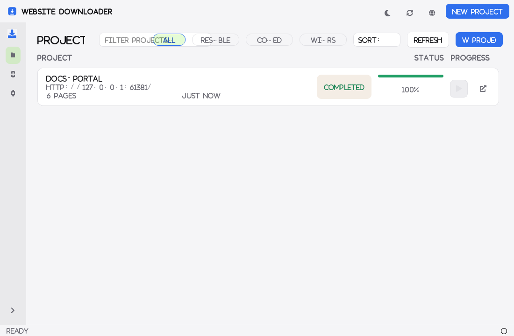
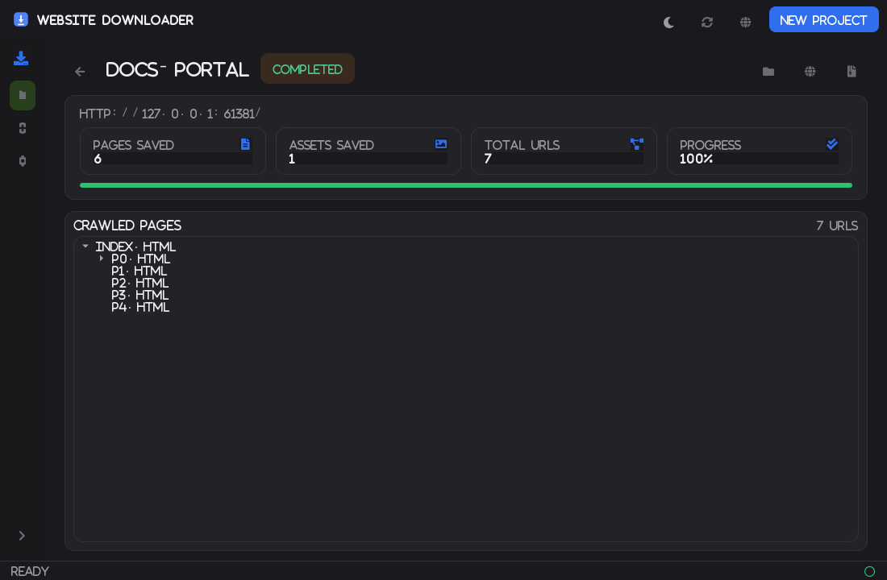
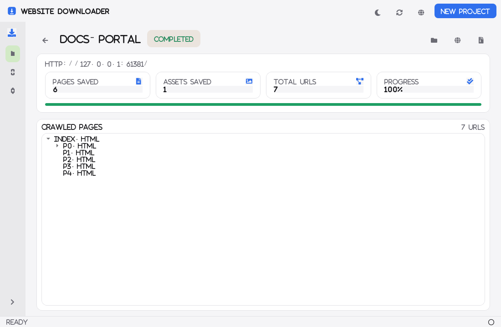
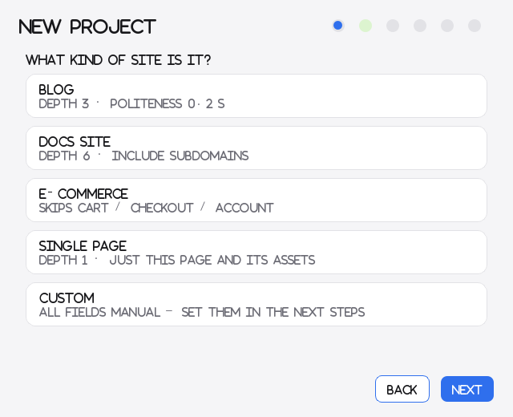
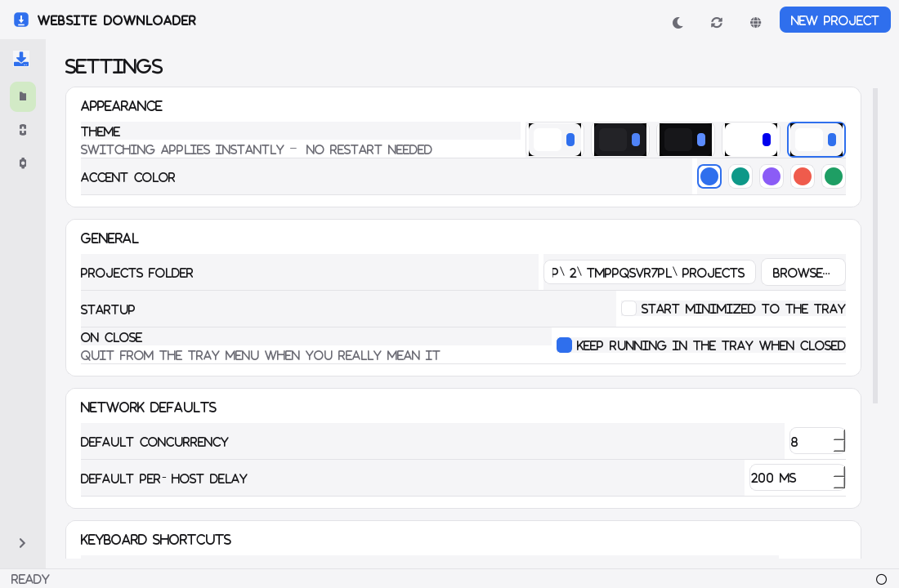
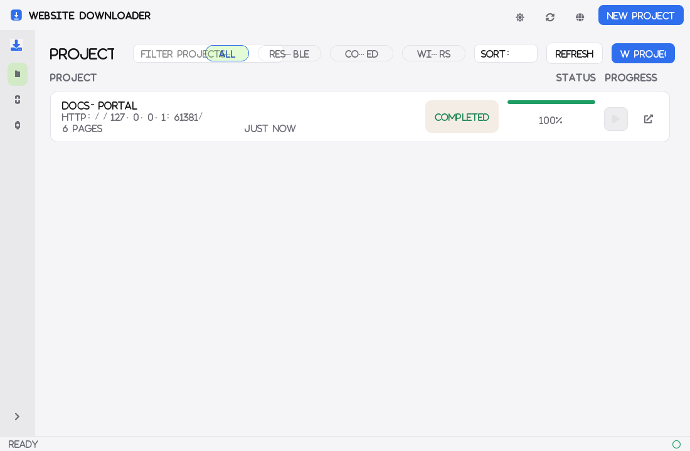

# Website Downloader

A fast, correct website mirroring tool with a desktop GUI: give it a URL and it
downloads every page and asset it finds, rewrites all internal links, and
produces a folder that works when opened offline — through `file://` or the
built-in local preview server. Crash-safe resumable projects, a rotating proxy
pool, full-text search over the mirrored pages, and optional headless-browser
crawling for JavaScript-heavy or login-gated sites.

```
python -m app.gui            # the desktop app
python -m app.cli <url>       # the CLI (same engine)
```

## Why this one (vs. HTTrack, wget, WebCopy)

The classic tools mirror a site. This one treats a mirror as a **project with
a memory** — and gets the offline details right that they don't:

| | wget / HTTrack / WebCopy | Website Downloader |
|---|---|---|
| **Crash resume** | Partial; HTTrack re-scans its cache, wget restarts queues | **SQLite-backed queue** — kill the process anywhere, re-run, and the resumed mirror is byte-identical to an uninterrupted run (proven by an automated equivalence test) |
| **Link correctness** | Redirects often leave stale/duplicate local targets | **Two-pass rewrite**: pages are saved raw, then rewritten with the *complete* redirect map — links through `old → new` redirects land on the right local file, never a duplicate |
| **Missing resources** | Dead links become broken relative paths (404 on `file://`) | Every intentionally-absent URL (robots-blocked, depth-capped, excluded, failed) is converted to **its absolute URL** — a saved page either works offline or degrades gracefully online, never 404s against the local layout |
| **JavaScript sites** | Not supported (you get empty shells) | Optional **headless-Chromium rendering** per page — JS-injected content *and JS-injected links* are captured and then crawled (acceptance-tested) |
| **Login-gated sites** | Manual cookie juggling, if at all | Paste cookies, or click **"Log in first"** — a visible browser opens, you log in, the session is captured for the crawl |
| **Search the result** | — (it's just files) | **SQLite FTS5 index** of every saved page, built automatically; query it from the GUI or SQLite |
| **Preview fidelity** | `file://` (no MIME negotiation, broken for odd filenames) | Built-in **local preview server** with proper Content-Types and directory→`index.html` resolution |
| **Blocking / politeness** | Fixed delays | Rotating **health-checked proxy pool** with per-domain pinning; a 403 through one proxy retries through another; **UA rotation** alongside |
| **Scope intelligence** | All-or-nothing or regex | Query-folded filenames, served-as-CSS always gets `.css`, extensionless pages become `path/index.html`, per-netloc scope (`host:port`), `www.`-stripping, Windows-safe sanitization |
| **Interface** | 2003 called | A Qt desktop app with a live dashboard, pause/resume/cancel, a projects list — and a CLI for scripting, both driving the identical engine |

**Engineering guarantees, not claims** — each bold behavior above has an
automated acceptance test: kill-and-resume byte-equivalence, exactly-once
fetching, `file://` resolution audits, JS-capture in headless vs plain HTTP,
and proxy rotation against mock forward proxies. 98 tests, all green.

## Screenshots

| Projects dashboard (dark · violet accent) | Project details & crawl tree |
|---|---|
|  |  |

| Live dashboard & log | New Project wizard | Settings (themes & accents) | Projects — light |
|---|---|---|---|
|  |  |  |  |

## The interface

A frameless, custom-designed desktop app — token-driven theming, motion, and
pro-tool ergonomics:

- **Theme engine** — every color, radius, spacing and animation duration is a
  *token* in one module; QSS is generated per theme. Five themes — **Light,
  Dark, Midnight (OLED), High-contrast, System** — switch instantly (no
  restart) and persist, plus a swatch **accent picker** (blue / teal /
  violet / coral / green) that overrides the accent across any theme.
- **Motion, done natively** — cross-faded page transitions, sliding wizard
  steps with animated dot indicators, count-up stat numbers, animated progress
  fills, card entrance fades, pulsing "Running" pill, toast notifications that
  slide in with countdown bars — all via one shared `animate()` helper, all
  150–250 ms with `OutCubic`, and **all disabled (<50 ms) when the OS
  "reduce animations" accessibility setting is on**.
- **New Project wizard** — six steps (Seed → Profile → Scope → Network →
  Output → Review) with profile presets (Blog / Docs / E-commerce / Single
  page / Custom), sliders with live readouts, and a horizontal slide between
  steps.
- **Live dashboard** — four count-up stat cards (pages / assets / speed /
  ETA), a large animated progress bar, a live **site-map tree**, and a
  color-coded, filterable, auto-scrolling **log panel**.
- **Pro-tool ergonomics** — command palette (**Ctrl+K**) with project + action
  search, global shortcuts (Ctrl+N/R/`,`/Space, F1 for the shortcut list),
  system-tray integration with an active-download badge, **close-to-tray
  mode** (the X hides to the tray; crawls keep running; tray-Quit exits for
  real), drag-and-drop a URL from any browser straight into the wizard,
  right-click context menus on project cards (Resume / Open / Export .zip /
  Rename / **Duplicate settings into a new prefilled project** / Delete),
  skeleton-loading shimmer, designed empty and error states, tooltips
  everywhere, first-run tips, and auto-saved window state.
- **Project details page** — double-click any project to open its saved
  crawl as an interactive **page tree built from the `link_edges` graph** in
  project.db (double-click a page to open the saved file), with stats,
  Resume, Open folder, browser preview and one-click **Export as .zip**.
- **Live dashboard extras** — a rolling **speed-history sparkline** painted
  in the active accent, and an activity log you can **export to file** or
  clear, filtered live by severity.

## Feature tour

| What | Where |
|---|---|
| Async crawler + two-pass offline rewriter (engine core) | `app/core/crawler.py`, `rewriter.py` |
| Crash-safe SQLite queue: kill/resume, identical result | `app/core/state_db.py` |
| Rotating, health-checked proxies + UA rotation | `app/core/proxy_manager.py` |
| Theme tokens → QSS (5 themes + accent picker, reduced-motion) | `app/gui/theme_engine.py` |
| Frameless shell: title bar, sidebar, tray, palette, shortcuts, toasts | `app/gui/main_window.py` |
| Shared motion helper + designed widgets (cards, pills, skeletons) | `app/gui/anim.py`, `widgets.py` |
| Six-step New Project wizard with slide transitions | `app/gui/new_project_wizard.py` |
| Projects dashboard: cards, filters, chips, sort, context menus | `app/gui/projects_view.py` |
| Project details: crawl tree from link_edges, export .zip | `app/gui/project_details.py` |
| Live dashboard: count-up stats, sparkline, site-map tree, log panel | `app/gui/live_dashboard.py` |
| Settings: live theme swatches, accent picker, shortcuts list | `app/gui/settings_view.py` |
| Local preview server (proper MIME, directory URLs) | `app/core/preview_server.py` |
| Full-text search over saved pages (SQLite FTS5) | `app/core/search_index.py` |
| Headless Chromium crawling + login capture (Playwright) | `app/core/headless.py`, `app/gui/login_capture.py` |
| Packaging (PyInstaller + Inno Setup) | `packaging/` |

## Quick start

```powershell
python -m venv .venv
.\.venv\Scripts\pip install -r requirements.txt
.\.venv\Scripts\pip install -r requirements-dev.txt   # for tests
.\.venv\Scripts\python -m app.gui
```

CLI, against a real site with defaults (robots respected, 200 ms politeness,
resumable):

```powershell
.\.venv\Scripts\python.exe -m app.cli https://quotes.toscrape.com/ --depth 2 -o mirror
```

## Command line

```
python -m app.cli <seed_url> [options]
```

| Flag | Default | Meaning |
|---|---|---|
| `-o, --output` | `mirror_<host>` | output directory |
| `--depth` | `3` | max page-link hops from the seed |
| `--concurrency` | `8` | total parallel downloads |
| `--per-host-concurrency` | `4` | parallel downloads per host |
| `--delay` | `0.2` | politeness: min seconds between requests to one host |
| `--timeout` / `--retries` | `30` / `3` | per request; exponential backoff between attempts |
| `--max-pages` / `--max-file-size` | `0` / `50 MB` | crawl caps |
| `--user-agent` | bundled UA | override |
| `--ignore-robots` | off | ignore robots.txt (respect it by default) |
| `--subdomains` | off | also crawl subdomains of the seed host |
| `--exclude GLOB` | none | skip URLs matching a glob (repeatable) |
| `--proxy URL` | none | http/https/socks5 proxy, health-checked pool (repeatable) |
| `--pin-proxy` / `--rotate-ua` | off | per-domain sticky proxies / rotate User-Agent |
| `--headless` | off | render pages with headless Chromium (JS-heavy sites) |
| `--cookie NAME=VALUE` | none | send everywhere (repeatable, or `a=1; b=2`) |
| `--no-verify` / `--no-search` | off | skip link verification / the FTS5 index |
| `--no-db` / `--fresh` | off | run stateless / discard saved state |

## How the engine works

Two passes, one engine:

1. **Crawl pass** — an async worker pool (aiohttp) fetches the seed and every
   discovered URL. Responses are saved **raw** the moment they arrive. Every
   discovery is journaled to SQLite as `pending`; fetches transition
   `downloading → done/failed/skipped` in small one-row transactions (WAL
   mode), so a crash loses at most the one URL in flight.
2. **Finalize pass** — after the queue drains, every saved HTML/CSS file is
   re-read and rewritten using the **complete** redirect map, then indexed
   into `search.db`.

### Scope and rewriting rules

- Scope is the seed's **netloc** (`host:port`, `www.`-stripped). Pages on
  other hosts stay absolute (online); *assets* on other hosts are mirrored
  under a `host/` folder.
- URLs that are intentionally **not** in the mirror — robots-blocked,
  excluded, beyond depth, over `--max-pages`, oversized, failed — are
  rewritten from relative to **absolute**, so every link either points inside
  the mirror or harmlessly out to the web.
- Query strings fold into filenames (`theme.css?v=2` → `theme@1a2b3c4d5e.css`),
  extensionless pages become `path/index.html`, and served-as-CSS URLs always
  get a `.css` extension so `file://` MIME sniffing works.
- A trailing-slash-preserving normalizer plus `doc_base()` semantics keep
  parent-relative (`../../x`) references exact.

### Storage layout

```
mirror/
  index.html            # seed page (or a meta-refresh stub when seed != "/")
  css/ img/ ...         # site folder structure preserved
  cdn.example.com/…     # foreign-host assets under their host folder
  manifest.json         # stats, redirects, per-URL records, failures
  project.db            # SQLite crawl state — the resumable queue (WAL)
  search.db             # FTS5 index of every saved page
```

## Persistence & resume

Re-running the same command against an existing output folder resumes: rows
still `pending`/`downloading` are requeued, finished files are kept untouched,
skips/failures keep their leave-absolute semantics, and raw files from a
killed run are finalized by the completing run. A persistent `finalized` flag
decides whether hydrated files may be trusted.

```powershell
# kill it with Ctrl+C anywhere, then re-run the same command:
Resumed: 45 kept from the previous run, 0 requeued
```

## The GUI

- **New Project wizard** — six steps (Seed → Profile → Scope → Network →
  Output → Review) with profile presets, live-readout sliders, cookie paste
  and a "Log in first…" button that opens a visible browser and captures
  your session cookies.
- **Live dashboard** — count-up stat cards (pages / assets / speed / ETA),
  animated progress, a live site-map tree and a color-coded filterable log;
  Pause takes effect between in-flight requests (well under the 2 s
  acceptance), Resume/Cancel keep the project consistent.
- **Projects dashboard** — every project as a card (status pill, animated
  progress, last run) read from each `project.db`; inline search, status
  chips and sorting; Resume re-runs from the row, double-click opens the
  saved-project view; right-click for Export .zip / Rename / Delete.
- **Search** — type in the saved-pages box and press Enter; double-click a
  hit to open the local file.
- **Preview in browser** — serves the mirror with correct MIME types.
- **Theming** — Light / Dark / Midnight / High-contrast / System plus an
  accent-color picker, token-generated, instant, persisted.

## Testing

```powershell
.\.venv\Scripts\python.exe -m pytest -q
```

106 tests: URL/mapping units, rewriter fixtures, state-db units (lifecycle,
crash states), kill-mid-crawl → resume equivalence (byte-identical mirrors),
proxy rotation against mock forward proxies, theme-engine generation,
offscreen Qt tests for the worker/window/wizard/projects-view/details-view/
toasts, preview-server + FTS5 tests, and headless-mode acceptance
(JS-rendered content captured in headless mode, missed in plain HTTP).

## Packaging

```powershell
.\packaging\build_windows.ps1             # dist\WebsiteDownloader.exe (onefile, windowed)
.\packaging\build_windows.ps1 -WithInstaller   # + dist\installer\WebsiteDownloader-Setup-1.0.0.exe
```

- The exe accepts `--cli …` for scripted crawls.
- Frozen windowed builds get real NUL streams + a direct `os._exit` teardown
  (Windows GUI subsystem + detached handles otherwise stalls interpreter
  shutdown).
- Playwright's browser binaries are **not** bundled (~300 MB): the GUI shows
  a one-time prompt to run `playwright install chromium` when headless mode
  or login capture is first used.
- The Inno Setup script adds Start Menu/desktop shortcuts and an uninstaller;
  user project folders survive uninstall. Code-sign before wide distribution.

## Architecture

```
app/
  cli.py                 # argparse entry: flags -> CrawlConfig -> Crawler.run()
  gui/
    __main__.py          # window entry (+ --cli passthrough), splash, frozen teardown
    main_window.py       # frameless shell: title bar, sidebar, tray, palette, shortcuts
    theme_engine.py      # design tokens -> per-theme QSS; accents; reduced-motion
    anim.py              # the one animate() helper + cross-fades + count-ups
    widgets.py           # cards, pills, stat cards, toasts, skeletons, empty states
    sidebar.py           # icon nav with animated collapse
    projects_view.py     # projects dashboard: cards, filters, chips, context menus
    new_project_wizard.py # six-step wizard with slide transitions
    live_dashboard.py    # stat cards, animated progress, site-map tree, log panel
    settings_view.py     # live theme swatches, accent picker, shortcuts list
    worker.py            # ProjectWorker(QThread): engine <-> Qt signals
    login_capture.py     # visible-browser login -> session cookies
    preview.py           # thread-owned preview server
  core/
    crawler.py           # orchestrator: queue, scope, redirects, finalize, verify
    downloader.py        # aiohttp pool, backoff, robots gate, proxy rotation
    rewriter.py          # HTML/CSS extraction (lexbor) + link rewriting
    storage.py           # URL→path mapping, atomic writes, manifest
    state_db.py          # SQLite crawl state (urls/project_meta/link_edges)
    proxy_manager.py     # health checks, round-robin, pinning, UA pool
    preview_server.py    # local HTTP server for finished mirrors
    search_index.py      # FTS5 full-text index
    headless.py          # Playwright page rendering -> FetchResult
    projects.py          # project summaries from project.db (GUI-agnostic)
    types.py             # CrawlConfig / CrawlStats / FetchResult / ...
  utils/
    url_utils.py         # normalize, scope, classification, path mapping (pure)
    robots.py            # per-netloc robots.txt cache
```

The engine never imports Qt or argparse — `Crawler` takes a frozen
`CrawlConfig` and returns a `CrawlReport`; the GUI and CLI are thin shells
over the same code path.

## Roadmap

- [x] **Phase 1** — core engine + CLI (crawler, two-pass rewrite, manifest, verify)
- [x] **Phase 2** — persistence: SQLite resume, finalized flag, retry journal
- [x] **Phase 3** — proxy manager: health checks, rotation, pinning, UA rotation
- [x] **Phase 4** — PySide6 GUI shell: worker signals, wizard, pause/resume/cancel
- [x] **Phase 5** — theming + projects dashboard with resume
- [x] **Phase 6** — preview server + FTS5 search
- [x] **Phase 7** — headless crawling + cookie/login capture
- [x] **Phase 8** — packaging: PyInstaller onefile exe + Inno Setup script
- [ ] **Phase 9 (optional)** — scheduled re-sync, WARC export, diff/compare, plugins
